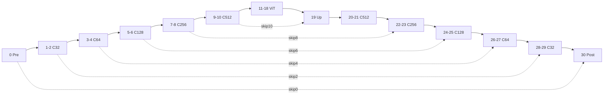

# DLSSNR 310.9.16.0：双模型资源、31块网络与HIP接入方案

日期：2026-10-18。分析基线：本仓0.43/main `9a7b4921`，生产代码载荷 `10982cf4`。本次只读DLL、解析/提取权重、编译运行**CPU**提取器与计划生成器；没有加载执行NVIDIA DLL，没有运行GPU/NGX、改生产HIP代码或安装文件。

## 1. 结论与证据边界

**不是换DLL就能得到新模型，也不是给71块网络加一个跳层列表。** 新DLL同时提供旧HT（Preset1）与重新训练的CC_SMALL_FP8（Preset2/default）。新模型保留所有通道宽度、8个ViT及相同算子家族，把重复Swin块缩到31块/76层；旧权重不能拿来填它。`DLSSNR.Hint.Render.Preset`是模型创建参数，与本仓`DLSS5_STYLE=0/1/2`的Style不是一个开关，Style2不会自动切Small。

本次直接核实的事实：

- 输入DLL大小266,424,944B、SHA256 `2bc19bc09a7b89dd44f73e2ac0108fcc586e2154bdd0830f242f4f040e28789f`，版本资源为310.9.16.0。
- 新DLL内HT资源与本地旧310.8.0 DLL的HT资源整段SHA一致；不是仅“大小一样”。
- Small资源77记录=76层payload+1个独立blend_scale；正式提取包255文件不是76层，也不是PR13的256文件。
- Python提取与指定Windows提取器源码的**Linux本机构建**输出完全相同：HT599项、Small255项均通过上游逐项校验。未冒充运行过Windows提取器.exe。
- 指定计划生成器实际运行确认1080→1920×1152/640token，900→1600×1024/448token，720→1344×768/288token。
- 按本仓已验证的Post物理布局重解新权重，RGB仍取0/2/4行、history取6行；新history行64B的SHA已经算出，不能继承旧64B资产。

证据分层：资源/封装/文件SHA来自本次DLL实读；类型/通道/移位/拓扑来自与该DLL SHA绑定的上游descriptor和指定提交的计划生成器；Preset选择及NV画面对账引用上游NGX验证。本次没有重新在5090跑Preset2，不把结构一致、有限输出或提取一致称作新模型HIP数值通过。

## 2. 固定源码版本、PR13与包格式差异

与DLL SHA绑定的上游descriptor名为 `CCNetwork`，config为 `hnet-crazy-cuckoo-small-fp8`、backbone为 `crazy-cuckoo`；它由RVA `0x602E0`及基厂 `0x5C5A0`的CPU仿真重建。本次核对了factory入口文件字节和资源，并未重新实现该仿真；descriptor里的 `0x200...` 地址属于仿真堆，不能当DLL RVA或文件偏移。

- [939b6072b792d0f45f8487a0b38a21d31264b6bc](https://github.com/mochizuki0323/DLSSNR-AMD/commit/939b6072b792d0f45f8487a0b38a21d31264b6bc)：Linux0.0.6的新模型支持。
- [191b97b54175d50c7ec5992b54322dd3eb0ef8ac](https://github.com/mochizuki0323/DLSSNR-AMD/commit/191b97b54175d50c7ec5992b54322dd3eb0ef8ac)：把Linux方案带到Windows0.0.6-alpha。两提交之间Linux core没有改动；191的Linux/Windows Small计划表逐字节相同。
- [PR13](https://github.com/mochizuki0323/DLSSNR-AMD/pull/13)：Overclockers/TheAutomatic的先行支持；feature `d6c146a`，末提交 `91d24dcb25b5c585f24a99f640d274d48f270c09`。PR是closed，末提交不是191的祖先；是后续实现吸收并致谢，不能写成“原样merge”。

|事项|PR13分支|939/191正式方案|
|---|---|---|
|Small条目|256|255|
|额外条目|`inventory/weights/block30.layer0.blend_scale.bin`|不打进pack|
|Small包SHA|`dc7edf0c5da0af3c3b2048bafa72f928f4f2eb89f117a37bc4c8863bb2645d8c`（PR记录）|`7e966e2639dbec6596aa0bac3b8761137d2c40ca8cb4aca30df7ca10043c6e33`（本次实取）|
|Small包大小|113,917,442B（PR记录）|113,917,248B（本次实取）|
|模型选择|从pack的post/ViT条目判别拓扑|caller > `DLSSNR_MODEL` > INI `[Network] Model`；默认small，缺small包/非installed tree时日志回落original|
|blend来源|读取独立2B条目，有限性检查并clamp|DLL/pack指纹固定后按模型用已知常量0x39EB或0x3A23|
|几何|原64对齐规则直接用于Small|Small追加Pre输出4mod8时的128轴对齐|

因此不能混用PR13的256条目指纹、正式255条目清单、另一个版本的planner。`nr_native_plan_data_small.hpp`里的 `b584f69e...` 是plan.model标识字符串，**不是本次pack SHA**；代码未给出其生成过程，不把它猜成权重指纹。

指定提取器：`extract_model.sh`从310.9.16写两个包，从310.8.0只写旧包；先按完整DLL SHA选择分支，随后逐文件校验，再写NRMODEL1。C++的 `dlssnr_extract_small_tables.hpp` 76个Layer和255个Entry，本次分别与descriptor和实际pack全部对齐。NRMODEL1：8B magic，u32 count/u32 reserved，逐项u32名称长度+UTF8名称+u64文件偏移+u64字节数，数据按256B对齐。其偏移是**导出包偏移**，不是DLL文件偏移。

本次HT包：147,756,560B，SHA `2b41c888cf4155b8958c665ba64018ab0bd25c85fc71a2b6db86d0d04d1f7fbd`。二进制模型保存在外部工作目录，不入本仓。

## 3. PE资源与记录格式

资源类型10为RCDATA，语言1033；类型16是版本。PE section及全部resource RVA/file offset见[resources.json](resources.json)。

|资源|文件偏移|RVA|字节数|记录数|资源SHA256|
|---|---:|---:|---:|---:|---|
|`10/WEIGHTS_CC_SMALL_FP8/1033`|`0x91734F0`|`0x918ECF0`|113,893,343|77|`f743e8eb320f42bc9bdc992ee2bf51f7bb7c8688ced4ecf5ce6807ec4eef7962`|
|`10/WEIGHTS_HT/1033`|`0x498DB8`|`0x4B45B8`|147,695,410|153|`836f445d06ecd2e59bb9f17b84b91c143396fd76ccda1c9dc7fe81d5edd548f4`|
|`16/1/1033`|`0x498910`|`0x4B4110`|1,188|—|`b89fb80211edcc1a21acead8d07c54897d9318f70300ee81a56d11189bd302f6`|

旧DLL为165,840,496B，SHA `e16bcf15e16e13f527491cdf7845b2fe6521a738d8f7c9c721866a8496e1fc8e`；其HT资源偏移0x114A160，新DLL移到0x498DB8，147,695,410B内容SHA均为 `836f445d06ecd2e59bb9f17b84b91c143396fd76ccda1c9dc7fe81d5edd548f4`。

资源内格式，全部little-endian：

```text
u64 total_resource_bytes
repeat until exact end:
  u64 name_bytes; byte[name_bytes] name
  u64 body_span
  body:
    u64 inner_span (=body_span)
    u64 payload_bytes
    u32 device_id
    byte[payload_bytes] payload
    u32 type_id; u32 layout_id; u64 ndim; u32[ndim] storage_shape
```

77/153条均边界闭合，无重名；本样本device_id=1、type_id=0、layout_id=0、ndim=1，body_span=payload_bytes+40，storage_shape=[payload_bytes/2]。这是opaque序列化容器，不是矩阵逻辑shape，不能看见type0/半字数量就把全部payload当FP16。实际混有E4M3矩阵、FP16向量/首尾投影、FP32温度和padding。

记录按名称字典序排列：block10在block2前，Small最后一条是block9.layer3，不是Post30。不能按文件次序走网络。512B对齐arena是旧NV运行时观察到的另一个地址域，本资源本身并没有把每个payload按512B填齐；NRMODEL1又是256B对齐的第三个域。

Small payload总和113,887,490B，HT147,683,778B。 Small的8个ViT层组自身占100,697,232B（Small原始payload的88.42%）。块数71→31不等于权重或帧时按31/71缩放。

### 3.1 Post30的blend与history头

|模型|序列化记录|DLL绝对文件偏移|half位型|数值|
|---|---|---:|---|---:|
|Small|`block30.layer0.blend_scale`|`0xFA4162A`|`0x3A23`|0.76708984375|
|HT|`block70.layer0.blend_scale`|`0x912CB52`|`0x39EB`|0.73974609375|

所谓“post70新blend”在Small里应叫**Post30**。该值用于learned gate的历史混合，不能乘到RGB头上当增强倍率。上游真实温度来自每个ViT QKV记录前128B的32个FP32，不是ViT Attention自带的2B opaque记录；这8个2B记录也没有导出进255文件pack。

本仓Post投影从payload+0x5130解16×32 FP16。旧行6复算SHA为 `77c745c4e1d84a6227a2224291d83c37d1e9bd18d45e95add166b1174225ce8f`，与0.43历史资产一致；新行6为 `c4c5f5189360756001e96abb43a482396ac8bde56f6ac4c7c19ae63db01d0980`。新旧非零物理行均0/2/4/6，RGB=0/2/4、history=6。

mochi的post解包canonical行号0/1/2/3和本仓物理行号/特征通道排列不同。本次还核到旧模型mochi行3的64B SHA不是上述旧行6 SHA；不能只拷`.out_project.bin`的一行或用行号替换，必须连特征通道顺序一起转换。

需要改的现有硬编码包括 `src/native_fast_history.h` 的 `.73974609375` 和 `hip_reference_network.h` 原history诊断支路。要独立传 `model_blend_scale`，不能把new/old比值提前乘historyStrength：当前saturate的位置会使大强度时语义不同。近似Fast History和已验证NV原生SIG/RTZ路径也要继续区分，blend改对不等于时序就对。

### 3.2 完整权重/shape/偏移索引

- [records-small.csv](records-small.csv)：全部77个原始记录，存储shape、payload大小、资源内与DLL绝对偏移、逐payload SHA；HT完整153项在[records-ht.json](records-ht.json)。
- [subtensors-small.csv](subtensors-small.csv)：全部291个矩阵/向量/header/padding区段，逻辑shape、物理shape、相对payload偏移及DLL绝对偏移；对应JSON另含SHA。
- [pack-small.csv](pack-small.csv)：全部255个正式导出文件名称、shape、pack偏移、来源区段起点与SHA，和C++生成表逐项相同。矩阵被反排列后并非DLL中的连续行主序切片；来源起点不能当作memcpy即可使用。

物理封装容易误读的几类：

|家族|矩阵/关键区段（payload相对偏移）|HIP接入注意|
|---|---|---|
|Pre0，21696B|expand[128,32]@0，contract[32,128]@4096，FP16 lift[32,16]@8208，QKV[96,32]@9312|输入纹理3通道不等于lift只有3输入；16特征及随机/history输入合同沿原参考重验|
|C32普通，20672B|expand@0、contract@4096、residual区@8192、QKV@8288、bias@11360、outproj@19568|scale/padding及通道排列要转换；Down/Up版的插入区不同|
|fused C64/128/256|expand[4C,C]；grouped mid存储[C,128]；mix[C,C]；QKV[3C,C]；bias[heads,64,64]；scalars_b FP32|grouped mid不是无约束dense[C,4C]；转换到本仓dense布局时保持结构零|
|C>=64 Up融合层|upsample_gain文件少前16系数，那16个在residual_scale尾部|`nr_graph.cpp`会重组；只读单个gain文件会错。atlas分清物理文件shape和完整逻辑gain[C]|
|split FFN，524288B|A[8,64,512]@0，Q0[8,256,64]@262144，Q2[8,64,256]@393216|按graph的ff_a/ff_q0/ff_q2位排列解三矩阵；不要沿用unpack_splitswin注释里的“两矩阵门控”解释|
|split QKV，917568B|FP8[1536,512]@0，FP16 bias[16,64,64]@786432，FP32温度[16]@917504|Q/K/V交错、bias query/key排列与本仓布局需映射|
|ViT expand|FP8[4096,1024]@0，16B尾|16B尾保留原证；不能把历史导出器忽略它推成NV所有版本都不用|
|ViT contract/projection|FP8[1024,4096]或[1024,1024]，后跟FP16 skip[1024]|尾是残差skip权重，不是给整个矩阵统一乘的dequant scale|
|ViT QKV，3145856B|FP32[32]头@0，FP8[3072,1024]@128|Q/K/V按1024B tile交错，不是三个连续1MiB片段|
|Post30，21808B|main_gain@8272、skip_gain@8336、QKV@8400、投影FP16[16,32]@20784|本仓完整Post解码、RGB与gate要一起重做；blend_scale另外占资源记录|

以上物理布局来自指定解包器及运行图，区别“记录覆盖闭合”与“数值/通道含义已经oracle验证”。例如残差区自带padding、Up gain跨区段，不能把上游每个bin都直接astype(f32)后拼成我们的文件。

## 4. 完整31块拓扑、移位及71块映射

下面尺寸为**新模型处理域1920×1152**下raster宽×高，不是有效1080行画面；B10最后一层输出转ViT视图，Post裁回实际输出。`old role`仅指现有函数/权重shape模板，绝不表示使用旧权重或照旧移位。

Shift表示HIP mask：0=(0,0)，1=(-4,0)，2=(0,-4)，3=(-4,-4)输入窗口原点；上游signed值是4像素tile单位(-1/0)。每层精确signed值和源/skip在[layers-small.csv](layers-small.csv)共76行中。

|新B|算子/输出层数|处理域输入→输出|Swin shift / old role原shift|old role|复用入口与差异|
|---:|---|---|---|---:|---|
|0|Pre/C32+pool / 1|1920×1152→960×576|0 / 0|0|C32Body(prefix) + pre.down|
|1|Swin C32 / 1|960×576→960×576|0 / 0|1|C32Chain|
|2|Swin C32+DS64 / 1|960×576→480×288|3 / 2|4|C32Chain(finish/down) + pool32；保存本级pre-down skip|
|3|Swin C64 / 1|480×288→480×288|0 / 0|5|Body(C64)|
|4|Swin C64+DS128 / 1|480×288→240×144|3 / 2|8|Body(raw C64) + Down64；保存本级pre-down skip|
|5|Swin C128 / 1|240×144→240×144|0 / 0|9|Body(C128)|
|6|Swin C128+DS256 / 1|240×144→120×72|3 / 3|14|Body(raw C128) + Down128；保存本级pre-down skip|
|7|Swin C256 / 1|120×72→120×72|0 / 0|15|Body(C256)|
|8|Swin C256+DS512 / 1|120×72→60×36|3 / 2|22|Body(raw C256) + Down256；保存本级pre-down skip|
|9|split-Swin C512 / 4|60×36→60×36|0 / 0|23|CompactC512Body|
|10|split-Swin C512+pool/head1024 / 5|60×36→32×20|3 / 2|30|CompactC512Body(raw) + Down(head)；保留C512 skip给19|
|11|ViT C1024 / 5|32×20→32×20|— / —|31|Vit；repack边界改11/18|
|12|ViT C1024 / 5|32×20→32×20|— / —|32|Vit|
|13|ViT C1024 / 5|32×20→32×20|— / —|33|Vit|
|14|ViT C1024 / 5|32×20→32×20|— / —|34|Vit|
|15|ViT C1024 / 5|32×20→32×20|— / —|35|Vit|
|16|ViT C1024 / 5|32×20→32×20|— / —|36|Vit|
|17|ViT C1024 / 5|32×20→32×20|— / —|37|Vit|
|18|ViT C1024 / 5|32×20→32×20|— / —|38|Vit；repack边界改11/18|
|19|decoder1024→512 / 1|32×20→60×36|— / —|39|Up(1024→512)|
|20|split-Swin C512 / 4|60×36→60×36|1 / 0|40|CompactC512Body|
|21|split-Swin C512 / 4|60×36→60×36|2 / 2|47|CompactC512Body|
|22|Up+Swin C256 / 1|60×36→120×72|1 / 0|48|Up(512→256) + Body(C256)；不硬塞旧C256 SpStage|
|23|Swin C256 / 1|120×72→120×72|2 / 2|55|Body(C256)|
|24|Up+Swin C128 / 1|120×72→240×144|1 / 1|56|UpBody(C128)|
|25|Swin C128 / 1|240×144→240×144|2 / 2|61|Body(C128)|
|26|Up+Swin C64 / 1|240×144→480×288|1 / 0|62|UpBody(C64)|
|27|Swin C64 / 1|480×288→480×288|2 / 2|65|Body(C64)|
|28|Up+Swin C32 / 1|480×288→960×576|1 / 0|66|C32UpBody；新shift=1；不启用已失败的C32 FP8-up候选|
|29|Swin C32 / 1|960×576→960×576|2 / 2|69|C32Chain(finish)|
|30|Post/C32+RGB / 1|960×576→1920×1152|3 / 3|70|post merge + C32 post/head|

层表的in0等于本block时，表示块内层依赖，不是block级回环；split Projection的残差取FfwdProj输出，QKV/Attention之间不能覆盖它。动态执行器至少按 `(model,block,layer,output_slot)` 标识张量，保留内部残差的live区间。

8个ViT各5层：Expand→Contract→QKV→global Attention→Projection；C512普通split块各4层，B10额外FinalHead为第5层，B19只有decoder up一层。合计76，不是31个GPU dispatch。

|家族|HT块数|Small块数|
|---|---:|---:|
|C32（含Pre/Post）|10|6|
|C64|8|4|
|C128|12|4|
|C256|16|4|
|C512 split|16|4|
|ViT C1024|8|8|
|ViT→decoder桥|1|1|
|总计|71|31|

### 4.1 六条skip边

|消费块|主输入|skip生产者|必须保存的张量|
|---:|---:|---|---|
|19|18|10.layer3，ProjPool的pool前C512输出|C512@60×36，不是FinalHead的1024@32×20|
|22|21|8的Swin输出、Down前|C256@120×72|
|24|23|6的Swin输出、Down前|C128@240×144|
|26|25|4的Swin输出、Down前|C64@480×288|
|28|27|2的Swin输出、Down前|C32@960×576|
|30|29|0的完整Swin输出、Pre pool前|C32@1920×1152|

`Record.skip`是**76层表中的ordinal**，并不总是block ID：19的skip=16，指10.layer3；22/24/26/28分别8/6/4/2，才碰巧等于block编号。数据流里的`in1`才直接写10/8/6/4/2/0。`skip_original=true`恢复生产者before的空间尺寸，不意味着跳接拿原始RGB。



### 4.2 不能靠改几个for循环完成的原因

- `WeightElements()`以旧block范围推C，并硬编码head-matrix/decoder39/post70名称。新11是ViT，但现函数把11当C128；新22是Up C256，而旧22是encoder末层。必须分离逻辑ID、legacy kernel role和资产名。
- `Run()`固定1..4、starts={5,9,15}、counts={4,6,8}、23..30、31..38、40..47及48/56/62/66/70；`Shift()`只接受40..69。encoder shift循环和decoder shift都要由Small表给，不能跳过旧块后沿用余下shift。
- `Body()`对48/55/61/65的post模式、`CompactC512Body()`的raw/skip、`C32Chain`的finish/down有位置语义。仅把新ID传入会改变边界舍入/quantization。先保持旧角色的kernel数学，显式传新节点的shift/terminal模式。
- `Vit()`、`VitEntryExitByteOk()`、`C512ByteStreamOk()`、复用gain累乘都写死旧端点/编号；必须改成ModelSpec。Small仍8个ViT，但首11/末18而非31/38。
- 现有`SpShift()`用旧编号猜级别；旧SpStage是6层C256中段，Small仅一plain层接Down或Up。上游专门把“单plain层+可折叠DS/UPS”视作persistent run；这不是我们现有SpStage直接适用的证明。首版禁Sp/PDL/Pulse，后续按新图单独测；不要重开已STOP的hipGraph。
- 新28对应C32 Up，当前量产C32低分辨率输入仍可能是f32（CW_UP_LOW_BYTES=0）；此前尝试补65→66并做C32 FP8 Up已Gold失败。本方案复用已验F16 C32 Up并参数化shift，不顺带带入失败候选。

## 5. 几何：工作域、逐节点round-up与ViT

计划表字面数字是生成时的样例，不是新1080执行参数。`make_native_plan`重新写W/H、tokens和grid；实际Step.W是raster高度、Step.H是raster宽度。图像没有旋转。尤其不能从表中ViT旧字面tokens=2560推断新ViT有2560token；实际1080是640。

令up(n,a)=ceil(n/a)*a。Small规则按 `nr_native_plan.cpp`：

1. 入口要求输入每轴1..16384，0或超限拒绝。先用未对齐输入走完整图，在每次block切换时分别累计轴尺寸实际变小的次数nx/ny；基础ax=2^nx、ay=2^ny。本报告输入轴≥320的常用案例均为六次，故ax=ay=64；极小/细长输入不能把6硬编码。
2. 对每个**输入轴**n，若`up((n+1)/2整数除法,4)%8 == 4`，该轴对齐翻倍到128。
3. workingW=max(320,up(inputW,ax))，workingH=max(320,up(inputH,ay))。
4. 若workingW整除4ax且workingH整除4ay，workingW+=ax。注意ax/ay可能不同，不能统统写成“均为256倍数”。
5. max(320,...)的执行顺序也要保持；它不是先把输入抬到320再重新align。每个Pre/Down/FinalHead独立做`out_axis=up((in_axis+1)/2整数除法,4)`，不是只在全图开头补齐后处处`W/2^n`。
6. Decoder恢复skip对应的before/after尺寸；C32 SwinUp额外把输出轴round到8；Post恢复处理域，再按实际输出裁剪。

下表由**编译执行指定C++ planner**取得，完整计划文本在[plans/](plans/)，节点尺寸在[block-geometries.json](block-geometries.json)。

|输入W×H|Small工作域|ViT raster W×H / token|当前HIP固定档位或差异|
|---|---|---|---|
|1920×1080|1920×1152|32×20 / 640|固定1080同1920×1152/640|
|1600×900|1600×1024|28×16 / 448|固定900为1600×960/400；连900w也只有25×16=400|
|1280×720|1344×768|24×12 / 288|固定720为1280×768/240|
|2560×1440|2560×1472|40×24 / 960|free工作域可同；中间节点仍须各自round4|
|3840×2160|3840×2176|60×36 / 2160|free预算/缓存/高分辨率路径须另验|
|1288×720|1408×768|24×12 / 288|宽轴也可能触发128对齐，非只修1080高度|
|1600×908|1600×960|28×16 / 448|比900高却只pad960；规则不保证单调|
|1001×777|1024×832|16×16 / 256|free示例|
|1919×1079|1920×1152|32×20 / 640|odd输入仍需mirror与valid范围合同|
|320×320|320×320|8×8 / 64|最小尺寸/4像素轴特例仍需oracle|

**900不能只改H=1024。** width1600的逐级轴是1600→800→400→200→100→52→28；当前HIP用W/32=50、ViT宽25。新图C512 raster是52×32，ViT28×16；Down100→52时只有前50列有真实pool，后两列需要明确零填充和正确stride。把整张输入硬pad到1664虽然能让52整数化，却改变了更高层输入，不能冒充1600-native合同。

720新图宽1344→672→336→168→84→44→24，对应C512宽44，不是当前固定1280/32=40。1440高度1472也会在深层46→48 round-up；只对ViT head做对齐仍不足。`Down()`、`Up()`与`UpBody()`已接收部分独立尺寸参数，但现`Run()`主要从全局W/H除法派生，需要真正的逐节点几何。

本仓FreeProcessing的“64对齐+1088→1152特判”和1600档强制25×16仍是旧产品约定；Small不能直接继承。mochi Original分支继续用旧64规则，1080会给1920×1088；也不能为了支持Small而把本仓已验证旧HT1152路由改回1088。

输入mirror沿既有合同`2*extent-2-coord`，节点尾padding与输入mirror不是一回事。保留实际validW/H、workingW/H和每层raster/窗口grid三个边界；不要把1344的输入pad当成720档输出被拉宽。上游planner输入上限16384是逻辑尺寸检查，不等于HIP16GB显存可承载；首版保留现有预算限制，逐节点估算所有live tensor与history。

## 6. HIP接入实施顺序与验收

### P0 已完成：资源与图的独立确认

本报告生成77/153原始记录、291子区段、76层、255导出文件清单；Python/C++完整提取一致；HT资源与旧DLL同；真实newblend和按本仓布局的新gate SHA明确。**不需要再花时间重复验证这些封装事实。** 不在仓库提交DLL、模型包或权重值。

### P1 资产适配与模型身份

建议新增不可变ModelSpec：model_id/resource SHA、31个BlockSpec（type/channel/shift/terminal/down/up/skip）、ViT边界11..18、post30、blend0x3A23、weight manifest和geometry策略。旧Original保留71图和0.43默认，Small作为明确选项接入；本文建议的配置键尚未存在，不能在0.43配置里写一个model=small就当切换成功。

最小实现可建`RunSmall()`，复用上表legacy role的函数及已验packed格式，资产放独立Small目录；逻辑new ID、角色old ID、权重文件名与日志ID必须分开。若临时按old role命名兼容WeightElements，要把alias写入manifest并做完整shape核对，不是复制旧值/覆盖旧目录。最终再统一数据驱动runner。优先复用本仓原始raw解码器到自己的float/FP8布局，不直接拼接mochi255个bin。

网络构造时锁定模型；tensor/weight/compiled-plan/导入缓存、history与AE anchor均绑定模型指纹。切换模型需要GPU drain、重建/清空所有相关状态，首帧cold reset，不能让Small读旧HT的history或以相同文件名复用缓存。显式要求Small却缺资产应清楚失败；auto回落Original如采用，必须记录requested/effective model及原因，防止测了旧网却报新网。

### P2 首个1080正确性闭环

先固定1920×1080有效域/1920×1152处理域、full31、MP1、Style/seed明确、history/AE/skin关闭、graph/PDL/Sp/Pulse关闭，从既有数值参考路径开始（FAST_NUMERIC=0只是本仓参考档，不等于NV tag0.01 exact）。首个版本先保留明确的repack/中间张量与原F16 Up合同；已有W16/byte边只在每对producer/consumer数值门通过后开启，绝不顺带纳入10-17失败C32 FP8-up或gather折叠。

层级顺序：新Pre→C32/64/128/256 Down链→C512 encoder→Head/ViT11..18→19及20/21→22/24/26/28上采样链→30。保存每个节点输入/输出、处理/有效范围、FP16/FP8布局、权重SHA和实际kernel名，用310.9.16 **Preset2**同输入输出做新oracle。已有原语算术与27位Post投影参考可复用为工具，不自动等于新整网已验。

新Small建立独立gold；旧0900E489...继续保护Original，不能要求训练后不同模型等于它。对上游Vulkan结果的PSNR可作排错辅助，不能把“和mochi相同”替代“和NVIDIA Preset2相同”。不得以全finite、全非零、只有一帧可看或缺实际model命中算通过。

### P3 逐节点900/720/free、history与运行策略

实现exact NodeGeometry后再放1600×900（1024行、C51252列、448token）、1280×720（1344宽、288token）及odd/free。测试padding/reflect、Down有效尾、Up目标skip尺寸、跨行stride、最后一tile，以及镜像只做一次。别把本仓旧900/720的性能型几何当NV Small基准。

然后接learned temporal：新RGB/head/gate、0x3A23、两K16与SIG/RTZ路径、reset/MV缺失/exposure/resize/model切换；MODE1近似反馈和原生reference分开。MODE2/3、预测3x的残差/补偿策略是旧模型上的工程设置，不能不测就认为适合Small。ViT AE gain从新8个contract/projection的skip重新算，不复制旧gain。

最后才评估Small的Sp/单plain+Down/Up融合、submit pulse与PDL；它们在新拓扑的作用及开销未测，不能拿旧full71资格自动放行。INT4校准只属旧模型，禁用于Small；本仓也不引入INT4新路线。

### P4 性能、产品与回归

数值闭环后同批3轮ABBA，900/1080平均与p99同时记录；对照要明确是Small reference/fast还是旧HT，不跨批减绝对时间，不把不同模型输出差异记成优化误差。游戏内由Zero看同场景运动、建筑高光、人物皮肤与F9切换；不把上游约40%网络降时或5090的结果外推到我们的HIP整帧。

Original必须继续通过原gold及既有正常/AE/history/回绕、多遍、RE9和配置回落门；新model开关、模块资格和日志不能偷偷改旧图。gfx1200仍需双架构编译/真实ELF核验，真机证据另列。所有GPU/RTC实验沿现有game-check、gpu.lock、15秒游戏看门狗及盘余量纪律；本次静态分析没有占用amd9070 GPU。

## 7. 上游验证能说明什么

指定提交的[310.9.16 NGX验证](https://github.com/mochizuki0323/DLSSNR-AMD/blob/939b6072b792d0f45f8487a0b38a21d31264b6bc/docs/ngx-verification/310.9.16/NGX-VERIFICATION.md)记录了5090上Preset1与310.8输出同、default与Preset2同，以及Small在Vulkan对NV的单帧/短序列比较。那是上游的Linux/Mesa、Style0等配置；不是本次HIP通过，也不是Small跨场景画质优于HT的证明。

PR13报告的是其Windows/ACO-off版本，不等于191的全部路径，更不等于我们的0.43。尤其PR还没完成NV Small等价性时的限制，与后续维护者补的NGX文档要按时间分开读。新模型较旧模型编辑幅度不同是训练结果，不必把它解释为旧画面“更正确”。

本次只做plain ELF签名扫描发现新DLL8个未压缩CUDA ELF/符号、旧DLL15 ELF/231符号。**这是扫描器可见下界，不是新网络只有8个CUDA kernel**；未解压其他容器，不能据此宣布Swin/ViT代码消失或全部与旧版二进制相同。新模型可先复用我们算子家族的依据是层类型/shape/执行合同及后续数值门，不是该扫描数量。

## 8. 完整76层与77记录附表

完整可机读原证是本目录CSV/JSON和plans文本；不包含模型数据。下面列出全部层与序列化记录，避免只给汇总。

### 8.1 全部76层（层表signed shift；ViT/decoder的零值不表示局部窗口）

|B.layer|type|Cin→Cout|kind|signed sx,sy|源block / skip block|raw skip ordinal|
|---|---|---|---|---|---|---|
|0.0|CCTinlayoutFusedPreBlockSwin1H|3→32|Pre|0,0|-1 / -1|-1|
|1.0|CCTinlayoutFusedSwin1H|32→32|Plain|0,0|0 / -1|-1|
|2.0|CCTinlayoutFusedSwin1H|32→64|Down|-1,-1|1 / -1|-1|
|3.0|CCTinlayoutFusedSwin2H|64→64|Plain|0,0|2 / -1|-1|
|4.0|CCTinlayoutFusedSwin2H|64→128|Down|-1,-1|3 / -1|-1|
|5.0|CCTinlayoutFusedSwin4H|128→128|Plain|0,0|4 / -1|-1|
|6.0|CCTinlayoutFusedSwin4H|128→256|Down|-1,-1|5 / -1|-1|
|7.0|CCTinlayoutFusedSwin8H|256→256|Plain|0,0|6 / -1|-1|
|8.0|CCTinlayoutFusedSwin8H|256→512|Down|-1,-1|7 / -1|-1|
|9.0|CCSplitSwin16HFfwd|512→512|Plain|0,0|8 / -1|-1|
|9.1|CCSplitSwin16HFfwdProj|512→512|Plain|0,0|9 / -1|-1|
|9.2|CCSplitSwin16HQKVAttn|512→512|Plain|0,0|9 / -1|-1|
|9.3|CCSplitSwin16HProj|512→512|Plain|0,0|9 / -1|-1|
|10.0|CCSplitSwin16HFfwd|512→512|Plain|0,0|9 / -1|-1|
|10.1|CCSplitSwin16HFfwdProj|512→512|Plain|0,0|10 / -1|-1|
|10.2|CCSplitSwin16HQKVAttn|512→512|Plain|-1,-1|10 / -1|-1|
|10.3|CCSplitSwin16HProjPool|512→512|Plain|0,0|10 / -1|-1|
|10.4|CCSplitSwin16HFinalHead|512→1024|FinalHead|0,0|10 / -1|-1|
|11.0|CCVit1DFfnExpand|1024→4096|Plain|0,0|10 / -1|-1|
|11.1|CCVit1DFfnContract|4096→1024|Plain|0,0|11 / -1|-1|
|11.2|CCVit1DQKV|1024→1024|Plain|0,0|11 / -1|-1|
|11.3|CCVit1DAttention|1024→1024|Plain|0,0|11 / -1|-1|
|11.4|CCVit1DProjection|1024→1024|Plain|0,0|11 / -1|-1|
|12.0|CCVit1DFfnExpand|1024→4096|Plain|0,0|11 / -1|-1|
|12.1|CCVit1DFfnContract|4096→1024|Plain|0,0|12 / -1|-1|
|12.2|CCVit1DQKV|1024→1024|Plain|0,0|12 / -1|-1|
|12.3|CCVit1DAttention|1024→1024|Plain|0,0|12 / -1|-1|
|12.4|CCVit1DProjection|1024→1024|Plain|0,0|12 / -1|-1|
|13.0|CCVit1DFfnExpand|1024→4096|Plain|0,0|12 / -1|-1|
|13.1|CCVit1DFfnContract|4096→1024|Plain|0,0|13 / -1|-1|
|13.2|CCVit1DQKV|1024→1024|Plain|0,0|13 / -1|-1|
|13.3|CCVit1DAttention|1024→1024|Plain|0,0|13 / -1|-1|
|13.4|CCVit1DProjection|1024→1024|Plain|0,0|13 / -1|-1|
|14.0|CCVit1DFfnExpand|1024→4096|Plain|0,0|13 / -1|-1|
|14.1|CCVit1DFfnContract|4096→1024|Plain|0,0|14 / -1|-1|
|14.2|CCVit1DQKV|1024→1024|Plain|0,0|14 / -1|-1|
|14.3|CCVit1DAttention|1024→1024|Plain|0,0|14 / -1|-1|
|14.4|CCVit1DProjection|1024→1024|Plain|0,0|14 / -1|-1|
|15.0|CCVit1DFfnExpand|1024→4096|Plain|0,0|14 / -1|-1|
|15.1|CCVit1DFfnContract|4096→1024|Plain|0,0|15 / -1|-1|
|15.2|CCVit1DQKV|1024→1024|Plain|0,0|15 / -1|-1|
|15.3|CCVit1DAttention|1024→1024|Plain|0,0|15 / -1|-1|
|15.4|CCVit1DProjection|1024→1024|Plain|0,0|15 / -1|-1|
|16.0|CCVit1DFfnExpand|1024→4096|Plain|0,0|15 / -1|-1|
|16.1|CCVit1DFfnContract|4096→1024|Plain|0,0|16 / -1|-1|
|16.2|CCVit1DQKV|1024→1024|Plain|0,0|16 / -1|-1|
|16.3|CCVit1DAttention|1024→1024|Plain|0,0|16 / -1|-1|
|16.4|CCVit1DProjection|1024→1024|Plain|0,0|16 / -1|-1|
|17.0|CCVit1DFfnExpand|1024→4096|Plain|0,0|16 / -1|-1|
|17.1|CCVit1DFfnContract|4096→1024|Plain|0,0|17 / -1|-1|
|17.2|CCVit1DQKV|1024→1024|Plain|0,0|17 / -1|-1|
|17.3|CCVit1DAttention|1024→1024|Plain|0,0|17 / -1|-1|
|17.4|CCVit1DProjection|1024→1024|Plain|0,0|17 / -1|-1|
|18.0|CCVit1DFfnExpand|1024→4096|Plain|0,0|17 / -1|-1|
|18.1|CCVit1DFfnContract|4096→1024|Plain|0,0|18 / -1|-1|
|18.2|CCVit1DQKV|1024→1024|Plain|0,0|18 / -1|-1|
|18.3|CCVit1DAttention|1024→1024|Plain|0,0|18 / -1|-1|
|18.4|CCVit1DProjection|1024→1024|Plain|0,0|18 / -1|-1|
|19.0|CCDecInputUpsample|1024→512|DecoderUp|0,0|18 / 10|16|
|20.0|CCSplitSwin16HFfwd|512→512|Plain|0,0|19 / -1|-1|
|20.1|CCSplitSwin16HFfwdProj|512→512|Plain|0,0|20 / -1|-1|
|20.2|CCSplitSwin16HQKVAttn|512→512|Plain|-1,0|20 / -1|-1|
|20.3|CCSplitSwin16HProj|512→512|Plain|0,0|20 / -1|-1|
|21.0|CCSplitSwin16HFfwd|512→512|Plain|0,0|20 / -1|-1|
|21.1|CCSplitSwin16HFfwdProj|512→512|Plain|0,0|21 / -1|-1|
|21.2|CCSplitSwin16HQKVAttn|512→512|Plain|0,-1|21 / -1|-1|
|21.3|CCSplitSwin16HProj|512→512|Plain|0,0|21 / -1|-1|
|22.0|CCTinlayoutFusedSwin8H|512→256|SwinUp|-1,0|21 / 8|8|
|23.0|CCTinlayoutFusedSwin8H|256→256|Plain|0,-1|22 / -1|-1|
|24.0|CCTinlayoutFusedSwin4H|256→128|SwinUp|-1,0|23 / 6|6|
|25.0|CCTinlayoutFusedSwin4H|128→128|Plain|0,-1|24 / -1|-1|
|26.0|CCTinlayoutFusedSwin2H|128→64|SwinUp|-1,0|25 / 4|4|
|27.0|CCTinlayoutFusedSwin2H|64→64|Plain|0,-1|26 / -1|-1|
|28.0|CCTinlayoutFusedSwin1H|64→32|SwinUp|-1,0|27 / 2|2|
|29.0|CCTinlayoutFusedSwin1H|32→32|Plain|0,-1|28 / -1|-1|
|30.0|CCTinlayoutFusedPostBlockSwin1H|32→3|Post|-1,-1|29 / 0|-1|

### 8.2 Small全部77个记录（资源内部保持文件原始字典序）

资源内payload偏移加0x91734F0就是DLL绝对偏移。表里的shape是wrapper存储shape；逻辑矩阵shape见291区段atlas。

|name|resource payload offset|DLL file offset|payload B|storage shape|
|---|---:|---:|---:|---|
|`block0.layer0.layer`|`0x3F`|`0x917352F`|21,696|[10848]|
|`block1.layer0.layer`|`0x554A`|`0x9178A3A`|20,672|[10336]|
|`block10.layer0.layer`|`0xA656`|`0x917DB46`|524,288|[262144]|
|`block10.layer1.layer`|`0x8A6A2`|`0x91FDB92`|263,168|[131584]|
|`block10.layer2.layer`|`0xCAAEE`|`0x923DFDE`|917,568|[458784]|
|`block10.layer3.layer`|`0x1AAB7A`|`0x931E06A`|263,168|[131584]|
|`block10.layer4.layer`|`0x1EAFC6`|`0x935E4B6`|524,304|[262152]|
|`block11.layer0.layer`|`0x26B022`|`0x93DE512`|4,194,320|[2097160]|
|`block11.layer1.layer`|`0x66B07E`|`0x97DE56E`|4,196,352|[2098176]|
|`block11.layer2.layer`|`0xA6B8CA`|`0x9BDEDBA`|3,145,856|[1572928]|
|`block11.layer3.layer`|`0xD6B996`|`0x9EDEE86`|2|[1]|
|`block11.layer4.layer`|`0xD6B9E4`|`0x9EDEED4`|1,050,624|[525312]|
|`block12.layer0.layer`|`0xE6C230`|`0x9FDF720`|4,194,320|[2097160]|
|`block12.layer1.layer`|`0x126C28C`|`0xA3DF77C`|4,196,352|[2098176]|
|`block12.layer2.layer`|`0x166CAD8`|`0xA7DFFC8`|3,145,856|[1572928]|
|`block12.layer3.layer`|`0x196CBA4`|`0xAAE0094`|2|[1]|
|`block12.layer4.layer`|`0x196CBF2`|`0xAAE00E2`|1,050,624|[525312]|
|`block13.layer0.layer`|`0x1A6D43E`|`0xABE092E`|4,194,320|[2097160]|
|`block13.layer1.layer`|`0x1E6D49A`|`0xAFE098A`|4,196,352|[2098176]|
|`block13.layer2.layer`|`0x226DCE6`|`0xB3E11D6`|3,145,856|[1572928]|
|`block13.layer3.layer`|`0x256DDB2`|`0xB6E12A2`|2|[1]|
|`block13.layer4.layer`|`0x256DE00`|`0xB6E12F0`|1,050,624|[525312]|
|`block14.layer0.layer`|`0x266E64C`|`0xB7E1B3C`|4,194,320|[2097160]|
|`block14.layer1.layer`|`0x2A6E6A8`|`0xBBE1B98`|4,196,352|[2098176]|
|`block14.layer2.layer`|`0x2E6EEF4`|`0xBFE23E4`|3,145,856|[1572928]|
|`block14.layer3.layer`|`0x316EFC0`|`0xC2E24B0`|2|[1]|
|`block14.layer4.layer`|`0x316F00E`|`0xC2E24FE`|1,050,624|[525312]|
|`block15.layer0.layer`|`0x326F85A`|`0xC3E2D4A`|4,194,320|[2097160]|
|`block15.layer1.layer`|`0x366F8B6`|`0xC7E2DA6`|4,196,352|[2098176]|
|`block15.layer2.layer`|`0x3A70102`|`0xCBE35F2`|3,145,856|[1572928]|
|`block15.layer3.layer`|`0x3D701CE`|`0xCEE36BE`|2|[1]|
|`block15.layer4.layer`|`0x3D7021C`|`0xCEE370C`|1,050,624|[525312]|
|`block16.layer0.layer`|`0x3E70A68`|`0xCFE3F58`|4,194,320|[2097160]|
|`block16.layer1.layer`|`0x4270AC4`|`0xD3E3FB4`|4,196,352|[2098176]|
|`block16.layer2.layer`|`0x4671310`|`0xD7E4800`|3,145,856|[1572928]|
|`block16.layer3.layer`|`0x49713DC`|`0xDAE48CC`|2|[1]|
|`block16.layer4.layer`|`0x497142A`|`0xDAE491A`|1,050,624|[525312]|
|`block17.layer0.layer`|`0x4A71C76`|`0xDBE5166`|4,194,320|[2097160]|
|`block17.layer1.layer`|`0x4E71CD2`|`0xDFE51C2`|4,196,352|[2098176]|
|`block17.layer2.layer`|`0x527251E`|`0xE3E5A0E`|3,145,856|[1572928]|
|`block17.layer3.layer`|`0x55725EA`|`0xE6E5ADA`|2|[1]|
|`block17.layer4.layer`|`0x5572638`|`0xE6E5B28`|1,050,624|[525312]|
|`block18.layer0.layer`|`0x5672E84`|`0xE7E6374`|4,194,320|[2097160]|
|`block18.layer1.layer`|`0x5A72EE0`|`0xEBE63D0`|4,196,352|[2098176]|
|`block18.layer2.layer`|`0x5E7372C`|`0xEFE6C1C`|3,145,856|[1572928]|
|`block18.layer3.layer`|`0x61737F8`|`0xF2E6CE8`|2|[1]|
|`block18.layer4.layer`|`0x6173846`|`0xF2E6D36`|1,050,624|[525312]|
|`block19.layer0.layer`|`0x6274092`|`0xF3E7582`|525,312|[262656]|
|`block2.layer0.layer`|`0x62F44DD`|`0xF4679CD`|22,720|[11360]|
|`block20.layer0.layer`|`0x62F9DE9`|`0xF46D2D9`|524,288|[262144]|
|`block20.layer1.layer`|`0x6379E35`|`0xF4ED325`|263,168|[131584]|
|`block20.layer2.layer`|`0x63BA281`|`0xF52D771`|917,568|[458784]|
|`block20.layer3.layer`|`0x649A30D`|`0xF60D7FD`|263,168|[131584]|
|`block21.layer0.layer`|`0x64DA759`|`0xF64DC49`|524,288|[262144]|
|`block21.layer1.layer`|`0x655A7A5`|`0xF6CDC95`|263,168|[131584]|
|`block21.layer2.layer`|`0x659ABF1`|`0xF70E0E1`|917,568|[458784]|
|`block21.layer3.layer`|`0x667AC7D`|`0xF7EE16D`|263,168|[131584]|
|`block22.layer0.layer`|`0x66BB0C9`|`0xF82E5B9`|820,784|[410392]|
|`block23.layer0.layer`|`0x6783745`|`0xF8F6C35`|689,232|[344616]|
|`block24.layer0.layer`|`0x682BBE1`|`0xF99F0D1`|230,176|[115088]|
|`block25.layer0.layer`|`0x6863F4D`|`0xF9D743D`|197,184|[98592]|
|`block26.layer0.layer`|`0x68941D9`|`0xFA076C9`|70,048|[35024]|
|`block27.layer0.layer`|`0x68A53C5`|`0xFA188B5`|61,760|[30880]|
|`block28.layer0.layer`|`0x68B4551`|`0xFA27A41`|22,784|[11392]|
|`block29.layer0.layer`|`0x68B9E9D`|`0xFA2D38D`|20,672|[10336]|
|`block3.layer0.layer`|`0x68BEFA8`|`0xFA32498`|61,760|[30880]|
|`block30.layer0.blend_scale`|`0x68CE13A`|`0xFA4162A`|2|[1]|
|`block30.layer0.layer`|`0x68CE188`|`0xFA41678`|21,808|[10904]|
|`block4.layer0.layer`|`0x68D3703`|`0xFA46BF3`|69,936|[34968]|
|`block5.layer0.layer`|`0x68E487E`|`0xFA57D6E`|197,184|[98592]|
|`block6.layer0.layer`|`0x6914B09`|`0xFA87FF9`|229,936|[114968]|
|`block7.layer0.layer`|`0x694CD84`|`0xFAC0274`|689,232|[344616]|
|`block8.layer0.layer`|`0x69F521F`|`0xFB6870F`|820,288|[410144]|
|`block9.layer0.layer`|`0x6ABD6AA`|`0xFC30B9A`|524,288|[262144]|
|`block9.layer1.layer`|`0x6B3D6F5`|`0xFCB0BE5`|263,168|[131584]|
|`block9.layer2.layer`|`0x6B7DB40`|`0xFCF1030`|917,568|[458784]|
|`block9.layer3.layer`|`0x6C5DBCB`|`0xFDD10BB`|263,168|[131584]|

## 9. 复现与产物边界

`analyze.py`独立验证PE与资源封装，导入固定版本解包器的region规律生成atlas，并交叉检查Windows76/255表。`plan_probe.cpp`直接链接指定planner；`reproduce.sh`重跑CPU提取、C++一致性与计划，不调用GPU。执行时传本机固定191源码目录、两份DLL和外部scratch目录；模型只留scratch。本次外部目录 `/home/lmxxf/work/dlssnr-310916-analysis/`。

源码指纹见[provenance.json](provenance.json)，全部汇总见[summary.json](summary.json)，Python/C++提取日志随附。区域定义依赖的上游代码采用MIT许可（见UPSTREAM-LICENSE.txt）；本仓自己的exact解析/参考仍保持本仓许可。二进制DLL/模型不入git。

**交付状态：静态逆向和接入设计完成；Small HIP实现、GPU gold、时序、性能与游戏验收均未开始。0.43现有载荷、双游戏安装和发行ZIP保持原样。**
